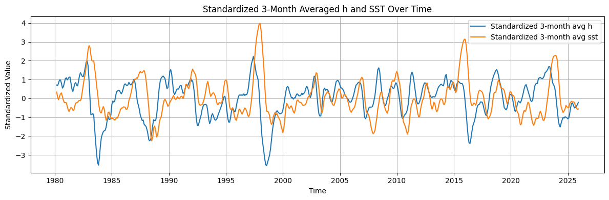
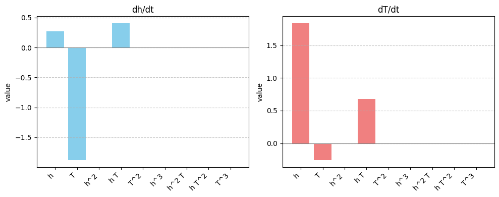
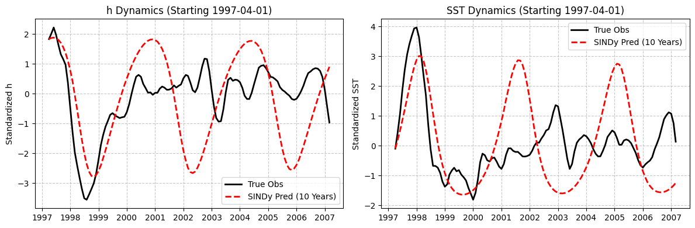
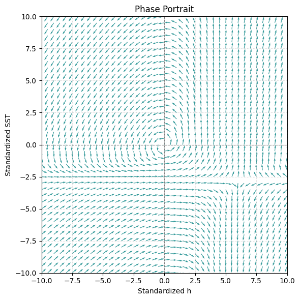

# SINDy-ENSO-Recharge-Discharge-Model

# 1. Introduction

ENSO is the dominant interannual variability over the equatorial Pacific and has significant impacts to the global climates. Jin Feifei (1997) developed a recharge-discharge oscillator model for ENSO that is represented by

$$\frac{dT}{dt} = CT+Dh - \varepsilon T^3,$$
$$\frac{dh}{dt} = -ET-R_h h,$$

where $T$ represents the SST anomaly in the equatorial eastern Pacific and $h$ represents the thermocline-depth anomaly in the equatorial western Pacific. The parameters $C$, $D$, $\varepsilon$, $E$ and $R_h$ are all positive constants. 

The physical explanations for the equations are clear. $CT$ represents the Bjerknes positive feedback. $Dh$ represents the recharge process, which means the deep thermocline will lead to the growth of the SST in the eastern Pacific. $ET$ is the discharge process. The growth of the SST will cause the westerly wind burst and thus lead to the severdrup transport from tropical Pacific to the subtropical Pacific, which shallows the thermocline. $R_h h$ adds a negative feedback to the change in the depth of thermocline, including turbulence dissipation and mixing. 

This work has been highly regarded by the academic community because it demonstrates that the fundamental dynamics of ENSO can be captured by a remarkably simple model. The model was developed based on earlier intermediate-complexity models (ICMs), such as the Zebiak–Cane model, together with Jin's profound physical insights into the GFD. An intriguing inverse problem then arises: can a similar dynamical system be constructed solely from observations? From a modern perspective, this question can also be formulated as a machine-learning problem.

# 2. SINDy

Since the recharge–discharge model is a dynamical system, a straightforward approach is to apply SINDy (Sparse Identification of Nonlinear Dynamical Systems). SINDy can be seen as a Sparse Regression, i.e. finding the optimal coefficient vector $c=(c_1, c_2,..., c_n)$ with the fewest nonzero entries to fit 

$$Y = c\Theta(X),$$

where $\Theta(X)=(f_1(X),f_2(X),..., f_n(X))^T$ is the function library. Here the labels $Y$ are the derivatives of $h$ and $T$ and the library contains the following polynomials,

$$\Theta(h, T) = (h, T, hT, h^2, T^2, h^3, T^3, h^2 T, h T^2)^T,$$

inspired by Jin's model.

# 3. Data and Deployment

The monthly data are downloaded from GODAS by the script `download_godas.py`. The climatology can be artificially downloaded from `https://www.psl.noaa.gov//data/gridded/data.godas.html`. The notbook `re_discharge_variables.ipynb` is designed to get the time series of $h$ and $T$, which are saved in the file `ENSO_h_sst_series.csv`. To filter out high frequency signals, we operate three-month moving average on the raw trime series. The training data are shown below. 

SINDy is mainly deployed in `SINDy_ReDischarge.ipynb`, where we take the advantage of the package `PySINDy`.

# 4. Results

## 4.1 Reconstructed ODEs
The coefficients fitted by the SINDy is ploted as follow,

The reconstructed ODEs can be formulated as

$$\frac{dT}{dt} = Dh + A(h - C)T,$$
$$\frac{dh}{dt} = -ET +B (T + R_h^*) h,$$

where $A$, $B$, $C$, $D$, $E$ and $R_h^*$ are all positive constants. 

Surprisingly but reasonably, the reconstructed ODEs poccess insightful physical meanings. First, the terms, $Dh$ and $ET$, are same as the classical recharge-discharge model, respectively represnting the recharge and discharge process. However, the remaining terms, $A(h-C)T$ and $B(T+R_h^*)h$, are quite different from those in the conventional one. As shown in the figure, the overall effects of these two terms to the system are both positive, so they can be physically regarded as the nonlinear Bjerknes feedback. The cross term $hT$ is contained in both equations and shows the positive effect, which means the growth rate of the Bjerknes feedback is not a constant (like the setting in Jin's model) but depends on the magnitude of another variable. Moreover, the nonlinear positive feedback is also modified by a constant. This constant may contribute to the amplitude asymmetry between El Niño and La Niña. 

## 4.2 Predictions for an El Niño event

We choose an extreme El Niño event 1997/98, which impacted the global climate and weather significantly, such as the flood disaster in China. The prediction begins from 1997-04. 

The system can approximately predict the tendency, amplitude and period of the El Niño event and the subsequent La Niña event, but is difficult to model the transition from strong-ENSO cycle to the weak-ENSO phase. This deficiency may attribute to the lack of sufficient damping and stochastic excitation. Generally speaking, it is impossible for a conceptual model to conduct the precise forecasting task.

## 4.3 Dynamical Properties

The reconstructed system is a quadratic planar autonomous system. Its extreme behavior is related to the Hilbert 16th problem, which has not been solved analytically till now. 

### 4.3.1 The Stable point, Stability and Period

The system poccess two stable point, which are clear on the phase portrait.

First considering the original point, the Jacobian of the system at $(0,0)$ is

$$J(0,0) = 
\left(
\begin{matrix}
0.270 & -1.883 \\
1.839 & -0.260  
\end{matrix}
\right)
$$

The eigenvalues for $J(0,0)$ are $\lambda_{1,2} = 0.005 \pm 1.842 i$. Thus the system is weakly unstable around $(0,0)$ and the preiod is $\frac{2\pi}{\omega} \approx 3.4$ years, within the observed period of ENSO. Another stable point is a saddle point, which will lead to divergence. This saddle point implies that the normalized SSTA in the eastern Pacific would never reach $-2.5$ in most cases. This result is in line with the observation that La Niña phenomena were relatively weak. 

### 4.3.2 Limit Cycle and Asymmetry

